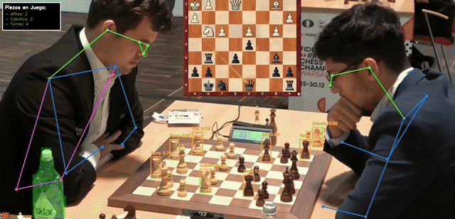

# Chess Vision Pipeline ♟️

Pipeline de visión por computadora que analiza una partida de ajedrez en video combinando **tres modelos YOLOv8 en un solo flujo**: detecta y cuenta piezas con un modelo entrenado a medida, segmenta el tablero y la mesa, y estima la pose de los jugadores.



## Qué hace

| Capa | Modelo | Tarea |
|---|---|---|
| A | YOLOv8n custom (`models/best.pt`) | Detecta alfiles, caballos y torres, filtra con NMS y cuenta piezas en tiempo real |
| B | YOLOv8n-seg (COCO) | Segmenta el entorno de juego, dejando sin pintar las piezas detectadas |
| C | YOLOv8n-pose (COCO) | Dibuja el esqueleto de los jugadores por encima de todo |

Un panel en la esquina muestra el inventario de piezas cuadro a cuadro.

## Resultados del modelo custom

Fine-tuning de YOLOv8 Nano, 50 épocas, imágenes de 640 px, validado sobre un subconjunto separado:

| Métrica | Valor |
|---|---|
| Precision | 0.908 |
| Recall | 0.816 |
| mAP50 | 0.896 |
| mAP50-95 | 0.747 |

## Decisiones técnicas

- **Skip frames:** se procesa 1 de cada 3 cuadros, lo que reduce el cómputo ~66% sin perder fluidez.
- **NMS con OpenCV** (`IoU = 0.4`) sobre un umbral de confianza de 0.25, para quedarse con una sola caja por pieza.
- **Capas ordenadas:** segmentación debajo, piezas en el medio y pose arriba, para que los brazos de los jugadores no queden tapados.
- **Alpha blending** al 30% para que la segmentación no sature la imagen.

## Cómo correrlo

```bash
pip install -r requirements.txt

# 1. (Opcional) Armar dataset a partir de un video
python src/extract_frames.py partida.mp4 --every 10

# 2. (Opcional) Reentrenar el detector
python src/train.py --data data/data.yaml --epochs 50 --device cpu

# 3. Procesar un video con el pipeline completo
python src/pipeline.py partida.mp4 --output resultado.mp4 --show
```

Los pesos `yolov8n-seg.pt` y `yolov8n-pose.pt` se descargan solos la primera vez.

## Dataset

[Ajedrez_YOLO26](https://universe.roboflow.com/eugenios-workspace-anlae/ajedrez_yolo26) en Roboflow Universe (licencia CC BY 4.0): 50 imágenes etiquetadas en formato YOLOv8, extraídas de video de una partida real. Clases: Alfil, Caballo, Torre.

El video de la demo es una transmisión pública del Campeonato Mundial de Rápidas y Blitz FIDE; se usa solo con fines académicos y de demostración.

## Equipo

Proyecto integrador de Redes Neuronales, Ingeniería en Inteligencia Artificial, Universidad de Palermo (2026).

Eugenio Altube · Simón Rubiño · Mariano Sánchez de Vera Bastone · Renato Rafael Lacherre Fernández · Franco Ariel Fariña · Jimena Medina

## Próximos pasos

- Sumar las clases faltantes (rey, dama, peón) y más imágenes de entrenamiento.
- Mapear cada pieza a su casilla para reconstruir la posición en notación FEN.
- Exportar el modelo a ONNX para inferencia en tiempo real.
